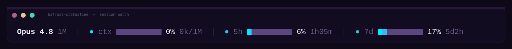
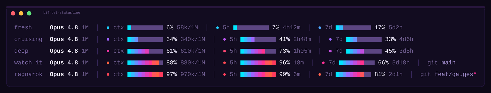

# bifrost-statusline

A synthwave status line for Claude Code and Codex CLI: model, context, and usage windows in one line.



## What it shows

- `ctx`, context window used
- `5h`, rolling five-hour usage window
- `7d`, rolling weekly usage window
- `git`, current branch, `*` if dirty



## Install

### Claude Code

**Auto:**

```bash
curl -fsSL https://raw.githubusercontent.com/ironmoose/bifrost-statusline/main/install.sh | bash
```

**Manual:** copy `statusline.py` to `~/.claude/bifrost-statusline.py` and add:

```json
"statusLine": {
  "type": "command",
  "command": "python3 ~/.claude/bifrost-statusline.py",
  "refreshInterval": 30
}
```

Needs Python 3.8+.

### Codex CLI

> [!IMPORTANT]
> Not a native Codex integration. Codex's footer can't run an external renderer, so Bifrost launches Codex inside a private tmux server and draws the line in tmux's status bar instead. Plain `codex` won't show it.

Needs Python 3.11+ and `tmux`.

```bash
python3 install-codex.py
```

```bash
~/.local/bin/bifrost codex
~/.local/bin/bifrost codex resume
~/.local/bin/bifrost codex --model gpt-5-codex
```

### Floating desktop strip

The optional desktop strip is one small always-on-top window with a bar for each
tool: Claude Code on top, Codex below. Each bar shows the model, context, and the
five-hour and weekly windows with reset times. It needs PySide6 in addition to the
normal Bifrost install:

```bash
python3 -m pip install PySide6
~/.local/bin/bifrost desktop
```

The Claude Code bar follows the session you last sent a prompt to; the Codex bar
follows the session whose rollout was written most recently. The Claude Code bar
needs the small mod in `claude-mod/bifrost-status`, which also works in the Claude
desktop app (where a `statusLine` command doesn't run). To watch one source only,
pass `--claude-status`, `--session <uuid>` or `--rollout <path>`. The strip reads
status only; it never changes Claude Code or Codex configuration. Setup and
details: [docs/desktop.md](docs/desktop.md).

The strip and its mod run on macOS and Linux. Windows is not supported yet: the
`bifrost` launcher is a shell script and the mod relies on `$HOME` and `mv`.

## Configuration

Layout is controlled by constants at the top of `statusline.py`: segment order, gradient style vs. flat fill, an optional frame, and the color ramp. Refresh cadence and how `ctx` differs from Codex's own percentage: [docs/telemetry.md](docs/telemetry.md).

## Docs

- [docs/desktop.md](docs/desktop.md): the floating desktop strip and its Claude Code mod
- [docs/codex.md](docs/codex.md): Codex CLI setup and internals
- [docs/telemetry.md](docs/telemetry.md): how the numbers work
- [docs/development.md](docs/development.md): tests and regenerating assets

## License

MIT, see [LICENSE](LICENSE).
